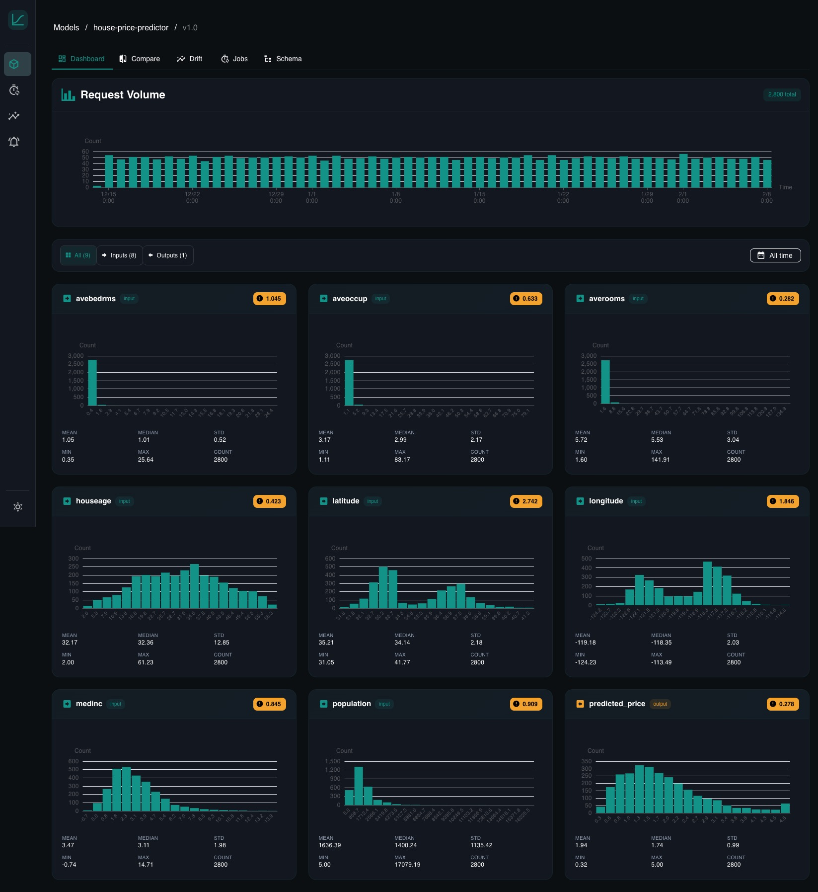

# Core Concepts

YAAI has a small surface area. There are six things to understand, and they chain together linearly.

## Models

A model represents a deployed ML system. "Fraud detector", "churn predictor", "price estimator" -- one entry per thing you want to monitor. It's just a name and a description.

## Projects

Every model belongs to exactly one **project**. Projects are the unit of access control: who can see and change a model is decided by the user's role in the model's project. Model names are unique *per project*, so two teams can both have a "churn-predictor".

A fresh installation (and every upgraded one) contains a project named `default`. Models created without an explicit `project_id` -- for example by older SDK scripts -- land there. The `default` project cannot be renamed or deleted.

Only global owners can create or delete projects (and only empty ones can be deleted). Models can be moved to another project by global owners only; names must not clash in the target project.

### Roles

Access combines the **global role** of a user with their **project role**:

| Capability | Global owner | Project owner | Project editor | Project viewer | Not a member |
|---|---|---|---|---|---|
| Access all projects and models | yes | no | no | no | no |
| Read models, versions, dashboards, drift results, jobs, notifications | yes | yes | yes | yes | no |
| Create models, versions, log inferences, upload reference data, edit/trigger jobs | yes | yes | yes | no | no |
| Manage project members, rename the project | yes | yes | no | no | no |
| Create / delete projects | yes | no | no | no | no |
| Move models between projects, delete models, list raw inferences | yes | no | no | no | no |

A global **viewer** is a regular user whose access comes entirely from project memberships. New users -- including users that are auto-created on their first Google login -- see no models until a project owner or global owner adds them to a project.

Service accounts keep their per-model access (`model_access`) and can additionally be added to a project with a role. They may read/write a model if either grants it. Service accounts without a membership may still create models in the `default` project and are granted per-model access to them, so existing SDK scripts keep working. When a service account creates a model through a project membership (editor), no per-model grant is added, so removing the membership removes the access. Service accounts can be project editors or viewers but not project owners.

The project name `default` is reserved. A project owner cannot remove or demote the last owner of a project (409); global owners can.

Memberships are always checked against the database, so changes take effect immediately.

### Projects in the web UI

- **Project filter** -- the header of the Models page has a "Project" selector (shown when you can access more than one project) listing "All projects" plus your projects. The model list is filtered by the selection and the choice is remembered in the browser; with "All projects" every model card shows its project. Jobs, Drift and Alerts always show everything you can access. Users who belong to no project see a hint to ask an administrator for access.
- **Projects page** (`Projects` in the navigation, shown when authentication is enabled) -- lists your projects with model count and your role. Global owners can create, edit and delete projects (the `default` project and non-empty projects cannot be deleted). Project owners can edit their project and manage its members: add users by username, change roles and remove members. Global owners can also pick users and service accounts from a list. Other users see their projects read-only.
- **Creating models** -- the "New Model" button is available to global owners and to editors/owners of at least one project; the dialog lets you choose the target project.
- **Model details** -- show the model's project; global owners get a "Move to project" action. Edit, new version, schema, job and threshold actions are only shown to editors and owners of the model's project (the backend enforces the same rules). On the global Jobs page, the job actions are shown per job according to the role in the job's project.
- **Global user management** (users and service accounts) stays in *Settings* and is available to global owners only.

## Versions

A model version pins a specific input/output contract. When your model's features change -- new input field, different output format, removed a column -- create a new version. This keeps historical data and drift results clean: version v1.0 results are never mixed with v2.0 data.

Versions are cheap. Create them whenever the contract changes.

## Schema

The schema is the core of YAAI. It's a list of fields that describes what your model takes in and what it produces:

```
age         input    numerical
income      input    numerical
region      input    categorical
churn_prob  output   numerical
```

From this, YAAI derives everything:

| What | How |
|---|---|
| **Dashboards** | numerical fields get histograms, categorical fields get bar charts |
| **Validation** | incoming inference data is checked against the schema |
| **Drift metric** | numerical defaults to PSI, categorical defaults to Chi-squared |
| **Comparison charts** | overlaid histograms for numerical, grouped bars for categorical |

You can define schemas manually or let YAAI infer them from a sample payload. Either way, the schema is the single configuration point. There is no other setup.

> [!NOTE]
> **Schema locking** — You can freely edit a schema until the first drift detection job runs. After that, the schema is locked to protect historical results. To change the schema, create a new version.

## Inference data

Inference data is what your model sees in production. Every time your model makes a prediction, send the inputs and outputs to YAAI:

```json
{
  "model_version_id": "...",
  "inputs": {"age": 35, "income": 72000, "region": "west"},
  "outputs": {"churn_prob": 0.73}
}
```

YAAI validates it against the schema, stores it as JSONB, and it immediately shows up in dashboards. Send data one at a time or in batches of up to 10,000.

Extra fields not in the schema are silently ignored -- this means your service can send more data than the schema defines without breaking anything.

## Reference data

Reference data is the baseline -- typically your training set or a known-good sample. It represents what the model's input distribution *should* look like.

Upload it once per version:

```python
await client.add_reference_data(model.id, version.id, training_records)
```

Drift detection compares recent inference data against this baseline. Without reference data, you can still use rolling-window comparison (today vs. yesterday), but `vs_reference` mode needs a baseline to compare against.

## Drift detection

Drift means the data your model sees has changed compared to what it was trained on. If your model was built for customers aged 20--50 and suddenly starts getting data for ages 60--80, that's drift. The model's predictions may no longer be reliable.

YAAI detects drift by comparing two distributions and measuring how different they are. Four metrics are supported:

| Metric | Data type | What it measures |
|---|---|---|
| **PSI** (Population Stability Index) | numerical | Bucket-by-bucket shift magnitude |
| **KS test** (Kolmogorov-Smirnov) | numerical | Maximum CDF distance, with p-value |
| **Chi-squared** | categorical | Frequency difference significance |
| **Jensen-Shannon divergence** | categorical | Symmetric distribution similarity |

Defaults: numerical fields use PSI, categorical fields use Chi-squared. You can override per field in the schema.

For a detailed walkthrough of how each metric works (with ASCII art and intuition), see the [Drift Detection Guide](drift-guide.md).

### Jobs

Drift detection runs on a schedule. A **job** defines:

- **When** to check -- cron expression (e.g., `0 2 * * *` for daily at 2am)
- **What** to compare -- `vs_reference` (against your baseline) or `rolling_window` (against the previous period). Currently, each job supports only one comparison type; combining both in a single job config is not yet supported.
- **How much** data to look at -- window size (e.g., "1 day", "7 days")

When you create a model version, YAAI creates a default job automatically (daily at 2am, comparing the last day of inferences against reference data). It activates when you upload reference data.

Each job run produces a drift result per schema field. If any field exceeds its threshold, a notification is created. Read state is tracked per user and per service account, so marking a notification as read only affects the person (or service account) who did it. With authentication disabled, a single global read flag is used. Notifications created before a user or service account existed count as read for them, so new accounts do not start with the historic backlog as unread.

### Comparison view

The comparison page is the interactive counterpart to automated drift jobs. Pick any two time ranges -- or compare inference data against reference data -- and see overlaid distributions for every field. Drift scores are computed inline.

This is useful for investigating shifts you've been alerted about or for ad-hoc exploration ("did anything change after last Tuesday's release?").

The page offers three modes:

- **Time window** -- two time ranges of the same version.
- **vs reference** -- inference data against your reference data.
- **Other version** -- the current version over period A against any other version you can read, on the same model or a different one (e.g. `model-xy-dev` vs `model-xy-prod`), over period B. Period B defaults to period A.

Only fields with the same direction, name, and data type in both versions are compared. Other fields are listed in `schema_diff` with status `only_in_a`, `only_in_b`, or `type_changed`. Renamed fields are not detected; they appear as one removed and one added field.

Without ground-truth labels, this shows distribution and behaviour differences, not which version is better.

The API endpoint for version-vs-version comparison (read access required on both versions):

```
GET /api/v1/models/{model_id}/versions/{version_id}/dashboard/compare?mode=vs_version&other_model_id=...&other_version_id=...&from_a=...&to_a=...&from_b=...&to_b=...
```

## Auto-dashboards

There's no dashboard builder. When you navigate to a model version in the UI, YAAI queries inference data for every schema field and renders:

- **Histograms** for numerical fields, with mean, median, std, min, max. Histograms always use 20 equal-width bins, including empty ones, so the x-axis is linear. If a tail reaches far beyond the 1st/99th percentile, the bins stop at that percentile and the outliers are collected in a separate `<p1` / `>p99` bar (dashed in the chart), so a few extreme values don't squash the rest of the distribution. Non-finite values (NaN, Infinity) are ignored. The "Log scale" switch on the dashboard and comparison pages turns the count axis logarithmic, so small bars stay visible next to a dominant one (empty bins are not drawn).
- **Bar charts** for categorical fields, sorted by frequency
- **Drift badges** showing the latest score per field

The time range is adjustable. Tabs filter by input vs. output fields.



## Authentication

YAAI supports four auth methods:

- **Local accounts** -- username + password, enabled by default. An admin account is created on first startup with a randomly generated password (written to a 0600 file, never logged -- see [Server Setup](server-setup.md#default-admin-account)). Owners can create additional users via the API. Public self-registration is disabled by default (`AUTH_LOCAL_ALLOW_REGISTRATION=false`).
- **Google OAuth** -- for human users via browser. Disabled by default. When enabled, local auth is automatically disabled.
- **API keys** -- for service accounts and SDK clients (`X-API-Key: yaam_...`). Enabled by default. Keys are scoped per-model and/or per-project.
- **Google service accounts** -- for GCP workloads using Application Default Credentials and ID token verification.

Two global roles exist: **owner** (super-admin with full access to every project) and **viewer** (a regular user whose access comes from [project memberships](#projects)).

Configure auth via environment variables (all prefixed with `AUTH_`). See the [Server Setup guide](server-setup.md#6-authentication) for details.
